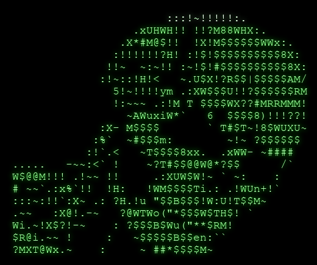
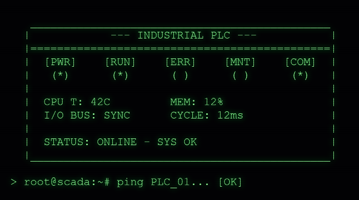
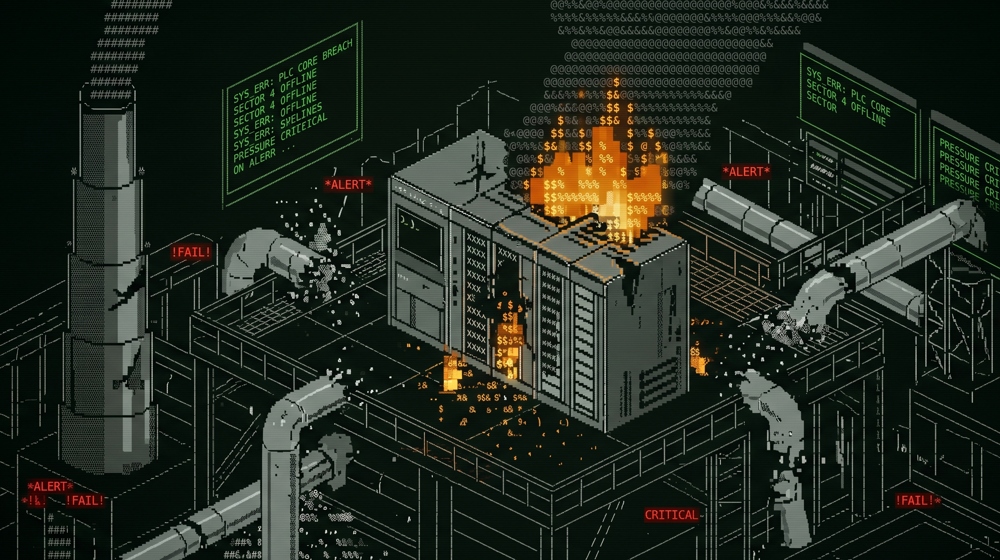

  

### [SYSTEM_IDENTIFICATION]
> ALIAS: z4y_d3n\
> DESIGNATION: OT/ICS Cybersecurity Analyst\
> STATUS: ONLINE

I specialize in auditing, pentesting, and exposing vulnerabilities within Industrial Control Systems (ICS) and Operational Technology (OT) networks. From deep protocol manipulation to the development of custom hardware implants, my objective is to demonstrate the fragility of critical infrastructure to ultimately forge more resilient systems.

---

### [CREDENTIALS_&_CLEARANCE]
> CYBERSECURITY COURSES & CERTIFICATIONS

* Certified Associate Penetration Tester (Hackviser)
* Certified Web Security Expert (Hackviser)
* Industrial Networking Essentials (Cisco NetAcad)
* Industrial Cybersecurity Essentials (Cisco NetAcad)
* CyberOps Associate (Cisco NetAcad)
* NSE 1, NSE 2 & NSE 3 (Fortinet)
* Network Security (Cisco NetAcad)

---

### [CURRENT_DIRECTIVES]

  

 

Researching and developing standalone hardware instruments for industrial protocol auditing.

**TACTICAL TOOLSET:**

* [**MODBUS TCP AUDITOR TOOL**](https://github.com/z4y-d3n/modbus-tcp-auditor-tool): Custom firmware developed specifically for the M5StickC Plus2, engineered to audit and penetrate Modbus TCP architectures. Capabilities include L2/L3 stealth reconnaissance, Function Code 43 (Device ID) fingerprinting, and direct manipulation of critical memory surfaces such as Coils and Holding Registers.
* [**S7COMM AUDITOR TOOL**](https://github.com/z4y-d3n/s7comm-auditor-tool): Custom firmware developed specifically for the M5StickC Plus2, engineered to audit and penetrate Siemens S7 communication TCP architectures. Capabilities include L2 hardware spoofing, SZL fingerprinting, and direct manipulation of Data Blocks (DBs) and I/O memory surfaces.
* [**MODBUS MIRAGE PLC**](https://github.com/z4y-d3n/modbus-mirage-plc): An interactive, asynchronous Modbus TCP PLC simulator engineered for OT/ICS security learning. Capabilities include live telemetry generation to defeat static fingerprinting, strict 0-based memory binding, and headless Docker deployment for validating industrial IDS/IPS rules and deploying high-fidelity honeypots.

--- 

### [OPERATIONAL_IMPACT]

  

 

> "Security by obscurity is a failing strategy in the industrial sector. We break the logic to secure the core."
